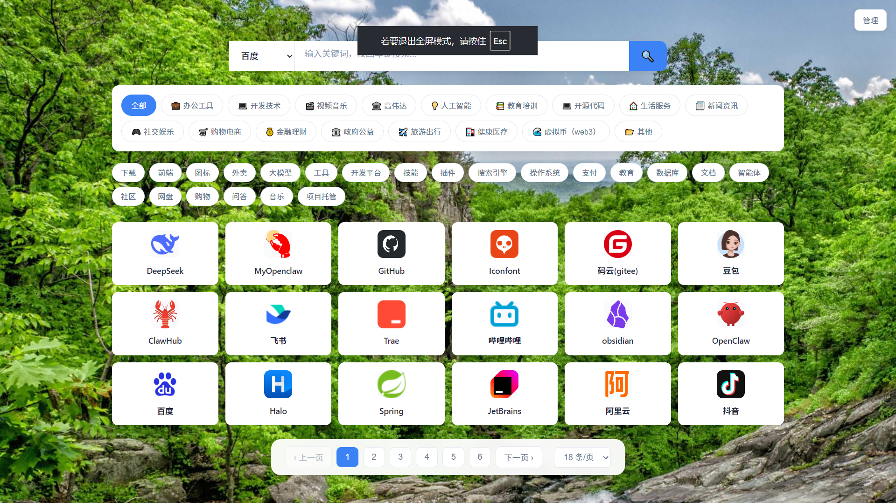

# Easy Web Tab

> 一个自托管的个人浏览器新标签页 / 工作台聚合应用。以「网址导航」为入口，叠加**教师工作台、个人工作台、销售记账（摆摊进销存）、学生工作台（含家长协同）、智能工作台、工具箱（129 个站内工具）、博客（含公众号草稿箱）、个人图书馆**等模块，纯前端 SPA，数据默认全部存在你自己的浏览器里，可选 WebDAV 云同步。



---

## ✨ 功能特性

| 模块 | 路由 | 一句话说明 |
|------|------|-----------|
| 网址导航 | `/` | 分类管理、双搜索（外部引擎 + 本站筛选）、断链检测、拖拽排序、Markdown 导入导出、经典 / 侧边栏双视图 |
| 教师工作台 | `/teacher` | 学期 × 班级隔离的班务台：课程表 / 点名 / 学生 / 班委 / 座位 / 成绩 / 试卷分析 / 值日 / 家长 / 奖励 / 请假 / 作业 / 家校谈话 / 小组 / 隐私信息，15 页 |
| 个人工作台 | `/workbench` | 主页 / 待办 / 便签 / 日记 / 倒计时 / 番茄钟 / 习惯打卡 / 密码库 / 健康管理（运动·饮食·睡眠·体重）/ 记账，10 面板 |
| 销售记账 | `/business` | 摆摊进销存：商品 / 进货 / 销售 / 支出 / 库存 / 统计，盈亏与趋势分析 |
| 学生工作台 | `/student` | 16 项菜单：习惯 / 作业 / 课表 / 计划 / 复习 / 错题 / 阅读 / 考试 / 成绩 / 目标 / 教育经历 / 健康 / 成就 / 奖励 + 家长协同（PIN 锁） |
| 智能工作台 | `/smart` | 技能库 / 提示词库（变量填充）/ 工作流库，导入先预览，独立 `smart.json` 信封 |
| 工具箱 | `/toolbox` | 129 个站内自建工具、19 个分类：开发 / 编码 / 数据 / 文本 / 图片 / 颜色 / 时间 / 计算 / 生成 / 效率 / PDF / 证书 / 文档 / 测量 / 媒体 / 贷款 / 科学 |
| 博客 | `/blog`、`/blog/admin` | Markdown 写作 + 图库 + 回收站 + 公众号草稿箱；前台列表与文章详情 |
| 个人图书馆 | `/books` | 静态书 + 本机上传 HTML 书，书架 / 收藏 / 书签 / 阅读进度 |
| 小游戏 | 菜单入口 | 孙子兵法、俄罗斯方块、小中高古诗、Cron 表达式生成器、号码生成器 |：所有个人数据默认存于浏览器 `localStorage` / `IndexedDB`，不上传任何服务器；可选项开启 WebDAV（坚果云 / Nextcloud 等）做多设备云同步。
- **暗色模式 + 背景壁纸**：内置 30 张壁纸，可替换；主题随系统或手动切换。
- **纯逻辑可测**：核心计算（倒计时、记账、健康、学生各模块）抽成纯函数，配 `node --experimental-strip-types` 单测（`npm run test:*`）。
- **中文本地化**：UI 全中文；Element Plus 全量注册并挂 `zh-cn` 语言包。

---

## 🚀 快速开始

```bash
# 1. 安装依赖（仅首次）
npm install

# 2. 本地开发（热更新，端口 16718）
npm run dev
# 浏览器打开 http://localhost:16718

# 3. 生产构建（生成 dist/）
npm run build

# 4. 预览生产构建
npm run preview
```

> 默认端口固定为 **16718**，访问地址 http://localhost:16718
> 构建实际由 `node scripts/build-safe.cjs` 包办：扫描 `public/icons` 生成 `presetIcons.ts` → `vue-tsc -b` 类型检查 → `vite build`，
> 并自动把 Rolldown 降到单线程（`RAYON_NUM_THREADS=1`）、V8 堆限到 1536MB，避免低内存机器上原生 OOM。
> 需要更高堆时显式传 `NODE_OPTIONS=--max-old-space-size=4096 npm run build`（脚本只在未设置时用默认值）。
> 提交前建议依次跑：`npm run typecheck` → `npm run lint` → `npm run build`。

### 一键启动（生产模式）

```bash
npm start          # 等价于 npm run build && npm run serve，启动后访问 http://localhost:16718
npm run serve      # 仅启动静态服务（读取已构建的 dist/，含游戏路由重写）
```

---

## 📄 页面与入口

| 页面 | 路由 | 说明 |
|------|------|------|
| 网址导航 | `/` | 添加 / 编辑 / 删除网址，管理分类、搜索引擎、图标、背景，导入导出 |
| 教师工作台 | `/teacher` | 15 个班务功能页，顶栏选学期 / 班级 / 身份 / 学科 |
| 个人工作台 | `/workbench` | 10 个面板：待办 / 便签 / 日记 / 倒计时 / 番茄钟 / 习惯 / 密码 / 健康 / 记账 |
| 销售记账 | `/business` | 摆摊进销存：商品 / 进货 / 销售 / 支出 / 库存 / 统计 |
| 学生工作台 | `/student` | 16 项学习管理菜单 + 家长协同 |
| 智能工作台 | `/smart` | 技能 / 提示词 / 工作流三库 + 概览 |
| 工具箱 | `/toolbox` | 129 个站内工具，搜索 / 分类 / 收藏 / 最近使用 |
| 博客后台 | `/blog/admin` | 文章 / 图库 / 回收站 + 设置（含公众号） |
| 博客前台 | `/blog`、`/blog/article/:slug` | 文章列表与详情阅读 |
| 个人图书馆 | `/books`、`/books/read?id=xxx` | 书架首页与站内阅读页 |

左上角「工作台切换面板」（`Alt+W`）统管 7 个工作台：导航站 / 教师台 / 个人工作台 / 销售记账 / 学生台 / 智能工作台 / 博客后台。
**工具箱、博客前台、个人图书馆**不在该面板里，而是作为「站内入口卡」固定在导航站列表最前（工具箱恒居第一位）；卡片名称 / 图标 / 显隐在 设置 → 导航设置 → 显示控制 里改。


### 方式一：双击运行（推荐个人使用）

直接双击根目录的 `run.bat` 即可启动（首次会自动安装依赖）。
> 前提：本机 `node` 已在系统 PATH 中（脚本不再写死 Node 路径）。

### 方式二：PM2 进程管理（推荐长期运行）

```bash
npm install -g pm2
pm2 start pm2.config.cjs          # 启动（内部用 serve 托管 dist/，端口 16718）
pm2 list / pm2 logs easywebtab    # 查看状态 / 日志
pm2 save                          # 保存，配合系统开机自启

# 开机自启（Windows，以管理员运行 PowerShell）
$taskAction = New-ScheduledTaskAction -Execute "powershell.exe" -Argument "-ExecutionPolicy Bypass -File `"$PWD\start-pm2.ps1`""
$taskTrigger = New-ScheduledTaskTrigger -AtLogOn
Register-ScheduledTask -TaskName "EasyWebTab-PM2" -Action $taskAction -Trigger $taskTrigger -RunLevel Highest

# 停止 / 重启
pm2 stop easywebtab
pm2 delete easywebtab
pm2 start pm2.config.cjs
```

### 方式三：Docker 容器

> ⚠️ **构建镜像的基础 Node 必须 ≥ 22.12**（与 `package.json` 的 `engines` 一致）。
> 若用 Node 20 构建，`re2`（metascraper 依赖的原生模块）会因 `node-gyp` 不兼容
> （`webidl.util.markAsUncloneable is not a function`）而安装失败。
> 推荐 `FROM node:22-bookworm` 或 `node:22.12-alpine` 作为构建/运行基础镜像。

```bash
docker build -t easywebtab .                    # 构建镜像（serve -s 托管 dist/，端口 16718）
docker run -d -p 16718:16718 --name easywebtab easywebtab
docker logs easywebtab
```

### 方式四：Nginx 静态托管 + 同源代理

用 Nginx 托管 `dist/` 时，页面本身纯静态，但有三个接口需要同源代理（否则浏览器跨域或静态 location 返回 405）：

1. **云同步（WebDAV）**：`POST /api/webdav-proxy`
2. **添加网站自动抓取元数据**：`POST /api/fetch-meta`（纯静态下 POST 落到静态 location 会返回 405，导致添加网站查询失败）
3. **公众号草稿箱**：`/api/wechat/*`（`open.feishu.cn` / 微信接口无 CORS，必须同源转发；仅用博客发文时需要）

推荐用三个轻量单职责代理（各占一个端口，pm2 常驻）：

```bash
npm run build                          # 产出 dist/
npm run webdav-proxy                   # WebDAV 同源代理，默认 127.0.0.1:16719
npm run fetch-meta-proxy               # fetch-meta 同源代理，默认 127.0.0.1:16720
npm run wechat-proxy                   # 公众号代理，默认 127.0.0.1:16721（无状态，凭证随请求发）
# 常驻：
# pm2 start scripts/webdav-proxy-only.cjs --name easy-webdav-proxy
# pm2 start scripts/fetch-meta-only.cjs --name easy-fetch-meta
# pm2 start scripts/wechat-proxy.cjs --name easy-wechat-proxy
```

Nginx 侧把两个 `/api/` 接口**精确反代**到对应进程：

```nginx
server {
  listen 443 ssl;
  server_name your-domain.com;

  root /var/www/easy-web-tab/dist;
  index index.html;

  # SPA fallback：刷新 /student 等子路由不 404
  location / { try_files $uri $uri/ /index.html; }

  # 云同步 WebDAV 代理
  location = /api/webdav-proxy {
    proxy_pass http://127.0.0.1:16719;
    proxy_http_version 1.1;
    proxy_set_header Host $host;
    proxy_set_header X-Real-IP $remote_addr;
    proxy_set_header X-Forwarded-For $proxy_add_x_forwarded_for;
    proxy_set_header X-Forwarded-Proto $scheme;
    proxy_read_timeout 30s;
  }

  # 添加网站：元数据抓取代理（解决 405）
  location = /api/fetch-meta {
    proxy_pass http://127.0.0.1:16720;
    proxy_http_version 1.1;
    proxy_set_header Host $host;
    proxy_set_header X-Real-IP $remote_addr;
    proxy_set_header X-Forwarded-For $proxy_add_x_forwarded_for;
    proxy_set_header X-Forwarded-Proto $scheme;
    proxy_read_timeout 30s;
  }

  # 公众号草稿箱代理（仅用博客推公众号时需要）
  location /api/wechat {
    proxy_pass http://127.0.0.1:16721;
    proxy_http_version 1.1;
    proxy_set_header Host $host;
    proxy_set_header X-Real-IP $remote_addr;
    proxy_set_header X-Forwarded-For $proxy_add_x_forwarded_for;
    proxy_set_header X-Forwarded-Proto $scheme;
    proxy_read_timeout 60s;
  }
}
```

> ⚠️ 必须用 `location = /api/fetch-meta` **精确匹配**，不能用 `location /api/`（否则会把两个代理混到一起、且静态文件请求也会命中，导致 405 / 502）。

代理协议：
- WebDAV：`POST /api/webdav-proxy`，请求头 `X-Webdav-Auth: Basic <base64(用户名:密码)>`，body 为 `{ target, method, body? }`。监听地址 / 端口可用 `WEBDAV_PROXY_HOST` / `WEBDAV_PROXY_PORT` 覆盖；`GET /healthz` 可作健康检查。
- fetch-meta：`POST /api/fetch-meta`，body 为 `{ url }`，返回 `{ title, description, icon }`。监听地址 / 端口可用 `FETCH_META_HOST` / `FETCH_META_PORT` 覆盖；`GET /healthz` 可作健康检查。
- wechat：`/api/wechat/*` 通用转发到微信开放接口，**无状态多租户** —— 代理本身不落盘任何 AppID / Secret，凭证随每次请求发送。监听地址 / 端口可用 `WEBCHAT_HOST` / `WEBCHAT_PORT` 覆盖。

> 两个代理**零运行时依赖**（仅 Node 内置模块），`metascraper` / `playwright` 未安装时自动回退正则解析，无需 `npm install`。
> 开发环境不需要这两个进程 —— `vite.config.js` 已内置同协议 dev proxy；`npm run serve` 启动的
> `scripts/serve-with-rewrites.cjs` 也已内置（单进程即可，端口 16718）。

---

## 🧭 使用指南

### 键盘快捷键

| 快捷键 | 功能 |
|--------|------|
| `Ctrl+D` | 切换暗色模式 |
| `Alt+W` | 唤起工作台切换面板（全站通用） |
| `Alt+K` | 全局搜索浮层（工作台 / 销售记账 / 学生台，跨待办/便签/倒计时/记账/密码） |
| `Alt+R` | 工具箱：唤起「最近使用」快捷条 |
| `Ctrl+Alt+1..9` | 跳转到工作台 / 销售记账的对应菜单项 |
| `g` | 在工作台与销售记账之间切换 |
| `[` / `]` | 在工作台 / 销售记账菜单模块间步进 |
| `Ctrl+S` | 博客 / 日记编辑器中保存 |
| `Esc` | 关闭弹窗 / 浮层 |


- **添加**：点击「+ 添加网址」或 `Ctrl+N` → 输入名称与地址 →「获取」自动拉取标题/描述/图标（经 Jina.ai，失败降级 allorigins 代理抓取 meta）→ 选分类、填标签 →「添加」。输入已存在网址会提示重复。
- **导入 / 导出**：设置（右上角 ⚙️）→「导航站」→「备份恢复」中上传 / 下载 `.md`（支持 YAML frontmatter），按 URL 去重，保留原有数据。
- **分类管理**：设置 →「导航站」→「分类管理」。
- **搜索引擎**：同区块「🔍 引擎管理」增删 / 设默认，搜索栏下拉切换。
- **断链检测**：同区块「断链检测」批量 HEAD/GET 校验书签可用性。
- **本地版本历史**：导航数据自动环形保留最近 10 版（`useBackup`），可一键回滚。
- **视图模式**：设置 → 导航设置 → 显示控制，可在「经典」（网格铺满）与「侧边栏」（左分类 + 右内容）间切换，选择随刷新保留。
- **站内入口卡**：工具箱 / 博客前台 / 个人图书馆固定排在网址列表最前，工具箱恒居第一位，不占网址数据。

### 个人工作台 `/workbench`

左侧菜单 10 项（均可改名 / 显示开关）：主页 · 待办 · 便签 · 日记本 · 倒计时 · 番茄钟 · 习惯打卡 · 密码 · 健康管理 · 记账。

- **主页**：问候条 + 三屏轮播（行动台 / 数据概览 / 工具），卡片可拖拽排序，6s 自动轮播。
- **待办**：自定义分类注册表、筛选 tabs、截止倒计时提示。
- **便签**：普通便签 + 时光轴双形态，分类筛选。
- **日记本**：每日一篇（本地日期唯一），Markdown 编辑 / 预览，历史卡片分页。
- **倒计时**：6 种重复规则（一次 / 每日 / 每周 / 每月 / 每年 / 间隔）+ 6 内置分类 + 自定义分类，5 种排序；到期三通道提醒（弹框 + 桌面通知 + 可选邮件摘要）。
- **番茄钟**：专注计时与统计。
- **习惯打卡**：左表单右卡片网格，连续打卡统计。
- **密码库**：crypto-js AES-CBC + PBKDF2 加密（纯前端，无需 HTTPS），主密码保护；支持导入 / 导出加密备份。
- **健康管理**：运动 / 饮食 / 睡眠 / 体重 四合一 tabs，目标计划 + 按天记录，BMI（国标 WS/T 428-2013）、达标率、趋势图；面板内嵌只读「定时提醒」区块。
- **记账**：六指标统计（收入 / 支出 / 结余 / 存款 / 笔数 / 支出比）+ 近 6 月收支趋势柱状图 + 支出分类占比环形图；金额默认掩码 `****`，可一键显隐；内置 8 分组不可删，支持计划自动复制。

### 销售记账（摆摊进销存）`/business`

布局复刻工作台，左侧固定 7 项：首页 · 商品 · 进货 · 销售 · 支出 · 库存 · 统计。

- 商品 / 进货 / 销售 / 支出全 CRUD，进货卡片按商品分类徽标、数量 × 单价自动合计。
- **库存** = 进货 − 带出 + 剩余，低库存阈值预警（默认 20，可配置），停售商品不参与。
- **统计**：营业额 / 成本（纯 COGS）/ 利润 / 毛利率 + 近 N 天趋势堆叠柱状图 + 分类 / 商品排行。
- 模块独立 JSON 备份（导入 / 导出，头部「📤 / 📥」）。

### 学生工作台 `/student`

独立页面，左侧菜单（学段 K/P/J 在首次引导 `StudentOnboarding` 强制选择）含：主页 · 习惯打卡 · 作业 · 课表 · 计划 · 复习 · 错题 · 阅读 · 考试 · 教育经历 · 日记 · 番茄钟 · 成就 · 奖励 · 家长协同。

- 14 个业务面板已统一为 Element Plus 组件（表单 / 弹框 / 表格 / 分页 / 滑块 / 颜色选择器等）。
- **成就系统**：内置 26 枚勋章（习惯连击 / 阅读 / 番茄 / 作业 / 复习 / 收集），自动解锁。
- **家长协同**（`StudentParent`）：6-tab（统计 / 每日任务 / 孩子报告 / 手动加分 / 发放勋章 / 配置奖励），`PIN` 锁（4–8 位，5 次错误锁 5 分钟），session 守卫在 `StudentView`。
- 学生数据走独立云同步信封，**不随工作台备份**。

### 教师工作台 `/teacher`

按「学期 × 班级」隔离数据的班务工作台。首次进入走引导，录入学年 / 学期 / 年级 / 班级 / 身份（班主任 · 科任）。

左侧 15 个功能页（顺序可在设置里自定义）：

- **课程表**：七列周课表，周次 / 导出 / 清空工具条 + 今日速览 + 学科图例，首列表头吸顶。
- **点名**：随机点名，名字轮换逐渐减速落定并写入历史，「只点一遍」模式排除已点过的学生。
- **学生信息**：统计卡 + 花名册（男蓝 / 女粉、特异体质红色「!」）+ 可编辑明细表，含导入与模板下载。
- **班委信息**：学号 / 姓名 / 职务 / 职责，与「学生信息」的职务字段双向联动。
- **座位表**：行列布局 + 按名单 / 随机排座 + 拖拽互换（移动端点选互换）。
- **成绩信息**：选考试 → 七项统计卡 + 分段柱状图 + 排名走势折线图 + 可编辑成绩表。
- **试卷分析**：按题录错误人数，自动算错误率并汇总「易错知识点排行」。
- **值日生表**：周一至周五排班 + 班委名单与职责。
- **联系家长**：按学生 / 家长 / 电话搜索，支持导入表格与导出纸质版（不提供一键拨号）。
- **奖励记录**：左侧选学生，右侧时间线记录，可附图片（canvas 压缩，单条最多 9 张）。
- **请假信息**：登记 → 审批 → 销假 → 统计 → 导出。
- **作业记录**：新建作业按名册生成未交记录，补交后标记；一键导出未交名单。
- **家校谈话**：按方式 / 分类记录沟通，双视图 + 筛选 + 统计 + 导出。
- **班级小组**：固定分组 / 临时分组 / 随机分组 / 分组快照。
- **隐私信息**：过敏原 / 慢性疾病 / 注意事项 / 紧急电话，仅班主任可见。

> **班主任 vs 科任**：非班主任自动隐藏座位表、值日生表、联系家长、请假信息、家校谈话、隐私信息 6 页。
> **数据管理 / 使用说明**已收进右上角「设置」弹窗，不再是左侧菜单项。

### 智能工作台 `/smart`

左侧 4 项（可改名 / 隐藏 / 拖拽排序）：

- **概览**：统计卡 + 分类分布 + 最近使用 Top5，点击直达。
- **技能库**：一个技能 = 一个目录（`skill.md` 的 frontmatter + 正文 + 附属资源），支持导入文件夹或 zip，导入先出「新增 / 更新 / 跳过」预览。
- **提示词库**：「使用」弹框可填变量，左填右预览；未填变量保留原 `{{占位}}` 并计数提示。
- **工作流库**：自由文本定义 + 多选批量导出 / 删除。

数据走独立 `smart.json` 信封；正文渲染关闭 HTML 注入（`html:false`）。

### 工具箱 `/toolbox`

129 个**站内自建**工具，19 个分类，全部在浏览器本地运行，不跳第三方站点、不上传文件到服务器。

| 分类 | 代表工具 |
|------|---------|
| 开发工具 | JSON / XML 格式化、正则测试、JWT 解码、cURL 转代码、Cron 构建器、WebSocket 测试 |
| 编码解码 | Base64、URL 编解码、Hash、字符转义 |
| 数据转换 | CSV ↔ JSON、JSON ↔ XML、Excel 匹配、HTML ↔ Markdown |
| 文本处理 | 文本对比、字幕工具、Markdown 编辑器、引用格式化 |
| 图片处理 | 压缩 / 裁剪 / 拼接 / 水印 / 抠图 / 证件照换底色 / 切片 / EXIF |
| 颜色设计 | 取色器、对比度检测、配色板、图表配色 |
| 时间计算 | 时间戳、世界时钟、日历、年龄计算、番茄计时 |
| 计算换算 | 单位换算、科学计算器、BMI、存款利息、个税 |
| 生成与随机 | UUID、二维码、密码、随机抽取、卡号 / 号码生成（仅测试用） |
| 效率工具 | 数据看板、抽奖、桌面清理清单 |
| PDF 工具 | 合并 / 拆分 / 压缩 / 加密 / 解锁 / 旋转 / 水印 / 提取 / 转 Markdown / 转 Office / 比较 |
| 证书与安全 | RSA 密钥、CSR 生成与解析、X.509 解析、PEM ↔ JWK |
| 文档处理 | docx 预览、docx 提图、文档属性编辑、合同生成 |
| 设备与测量 | 量角器、屏幕标尺、噪音计、指南针、摄像头拍照 |
| 媒体播放 | 媒体播放器、格式转换、语音转文字 / 文字转语音 |
| 贷款计算 | 等额本息 / 本金、组合贷、公积金、LPR、提前还款、利率变更 |
| 科学 | 元素周期表、中国地图 |
| 站内模块 | 工作台 / 博客 / 图书馆 / 小游戏入口 |
| 其他 | 杂项 |

- **收藏**：卡片右上角 ☆ → 顶部「常用工具」区。
- **最近使用**：顶栏常驻快捷条，`Alt+R` 唤起。
- **统计**：按点击次数排序，可一键重置。
- **云同步**：收藏 / 最近使用 / 点击次数 / 搜索历史走 `toolbox.json` 信封。

### 博客与个人图书馆

**博客后台 `/blog/admin`**：左侧 3 项 + 右上角设置。

- **文章**：Markdown 编辑器，含分类 / 标签 / 封面 / 摘要自动截取 / 阅读时长估算；保存带乐观锁（`revision`），冲突时由你决定覆盖或放弃。
- **图库**：多选上传、分类筛选、批量归类；被正文或封面引用的图片**禁止删除**，悬停列出引用它的文章。
- **回收站**：先删后进回收站，可还原或彻底删除（写墓碑，7 天后物理清理，期间不会被云同步「复活」）。
- **公众号草稿箱**：设置里填 AppID / Secret 后可把文章推到公众号草稿箱再排版发布。

前台 `/blog` 为列表（分类 / 标签筛选 + 收藏），`/blog/article/:slug` 为详情。

**个人图书馆 `/books`**：静态书（随站点构建，全体可见）+ 本机上传的 HTML 书合并展示，支持搜索 / 分类 / 标签 / 排序 / 收藏 / 最近阅读 / 书内书签。阅读页 `/books/read?id=xxx` 用 iframe 承载原书 HTML，自动记忆阅读位置。

> 上传的书只存当前设备的 IndexedDB，不进任何云同步信封；`books.json` 只同步收藏与书签。

### 小游戏

位于 `public/games/`，由 `manifest.json` 登记、经 `src/stores/sites.ts` 加载：

- 孙子兵法（`/games/sunzibingfa/`）
- 俄罗斯方块（`/games/tetris/`）
- 小中高古诗（`/games/gushi/`）
- Cron 表达式生成器（`/games/cron-generator/`）
- 号码生成器（`/games/id-generator/`）

> 小游戏是独立 HTML 应用；若用 `serve -s dist` 等无重写服务托管，相对资源可能 404，建议用 `npm run serve`（已内置游戏路由重写）。

### 云同步（WebDAV）

设置 →「云同步」填入 WebDAV 地址 / 账号 / 密码 / 同步间隔（配置**不进备份**）。

同步走 **11 份独立信封**，各自合并、一份坏掉不拖垮全部：

`nav.json` / `icons.json` / `workbench.json` / `business.json` / `student.json` /
`teacher.json` / `toolbox.json` / `smart.json` / `blog.json` / `blog-prefs.json` / `books.json`

- 记录型数据采用「并集 + 墓碑」合并：两端都保留，删除写墓碑而非物理移除。
- 导航冲突（本地脏 + 远端新 + diff > 500 字）弹出三选一（云端覆盖 / 本地覆盖 / 合并）。
- 密码库走「云端覆盖本地」，两端主密码不一致时要求输入来源设备主密码解锁。
- 触发时机：页面可见性变化 + 60s 轮询 + 手动。
- 只推变化信封：每份记录内容签名，未变化的信封不重传。
- `books.json` 仅含收藏与书签；上传的书、阅读位置、打开次数属设备级数据，不外传。

### 数据备份与快照

- **工作台 JSON 备份**（`WORKBENCH_DATA_VERSION=9`，兼容 v1–v9）：导出 / 导入整库；v8 起内嵌密码加密身份（盐 + 验证串），跨设备导入后用原主密码解锁。
- **学生独立备份**（`student-backup` 信封，`STUDENT_DATA_VERSION=1`）。
- **快照（时光机）**：环形保留最近 10 份 IndexedDB 全量快照，可回滚。

### 备案信息

全站所有页面（App.vue 全局挂载）底部居中自动显示备案页脚：ICP 备案号点击跳转工信部备案系统；公安联网备案号带徽标跳转公安备案查询平台。

配置方式（写死常量，无设置界面）：

1. 编辑 `src/config/beian.ts`：填入 `ICP_NUMBER` / `PSB_NUMBER`（空串 = 对应段不显示；两段都空 = 整个页脚不渲染）。
2. 公安徽标下载自全国互联网安全管理平台（`beian.mps.gov.cn`），放入 `public/beian/ghs.png`（`@error` 兜底隐藏）。
3. 重新构建部署（`npm run build`）后生效。

---

## 💾 数据存储

- **内置数据**：`public/data/sites.md`（默认初始网址，构建时复制进 `dist/`）；`public/data/sites.zip`（「下载示例数据」源：`sites.md` + `icons/` 图标目录，可在管理后台「导入」处直接上传）；`public/backgrounds/`（壁纸）、`public/icons/`（预设图标）、`public/bookdata/`（静态书）、`public/games/`（小游戏）。
- **导航数据（IndexedDB `nav` store）**：`user-sites` / `user-categories` / `user-search-engines` / 主题 / 各类排序与分类偏好（如 `user-todo-categories`、`user-countdown-categories`）。v18 起从 localStorage 迁入，根治移动端被系统回收导致的导航丢失；图标缓存独立存 `iconcache` store。
- **localStorage 仍有**：断链检测结果、`password-verification-v2`、少量设备级标记。
- **个人 / 业务 / 学生 / 教师 / 工具箱 / 智能台 / 博客数据（IndexedDB）**：数据库名 `easy-web-tab`，当前 **`DB_VERSION=23`**，object store 分族：
  - 核心 10：`todos` / `notes` / `diary` / `countdowns` / `passwords` / `health` / `ledger` / `settings` / `business` / `family`（随 JSON 备份导出）
  - 辅助 3：`pomodoro` / `habits` / `snapshots`
  - 图标 1：`icons`；图标缓存 1：`iconcache`
  - 学生 19：`student_settings` / `student_habits` / `student_homework` / `student_timetable` / `student_plans` / `student_review` / `student_goals` / `student_mistakes` / `student_reading` / `student_countdowns` / `student_education` / `student_health` / `student_grades` / `student_achievements` / `student_rewards` / `student_parent_tasks` / `student_images` / `student_diary`（共享副本）
  - 其它：`teacher_workbench`（教师）、`nav` / `navmeta`（导航偏好与降级守卫基线）、`lottery`（抽奖）、`blog`（博客单对象）、`books`（本机上传书）

### 多浏览器 / 设备迁移

- **导航**：在设置 →「导航站」→「备份恢复」点「导出」下载 `sites.md`，到另一浏览器「导入」。
- **工作台 / 学生 / 教师**：在对应页面导出 JSON 备份，再到另一浏览器导入（v8+ 备份内嵌密码加密身份，用原主密码解锁）。
- **清除数据**：F12 → Application → IndexedDB 下删除 `easy-web-tab` 数据库；若 localStorage 仍残留旧快照（`user-countdowns` / `user-passwords`），需一并清除才干净。
（面向贡献者 / 智能体）

### 环境要求

- **Node.js**：>= 22.12（纯函数测试依赖 `node --experimental-strip-types`（Node ≥ 22.6），Vite 8 要求 ≥ 22.12）
- **包管理器**：npm（不依赖 pnpm / yarn / bun）
- **开发端口**：http://localhost:16718（配置于 `vite.config.js`）

### 核心依赖

| 依赖 | 用途 |
|------|------|
| `vue@3` / `pinia@3` / `vue-router@5` | UI 框架 / 状态管理 / 路由（12 条路由，全部懒加载按模块分包） |
| `vite@8` / `typescript@5` / `vue-tsc` | 构建（Rolldown）/ 类型系统（strict）/ 类型检查 |
| `element-plus` | UI 组件库（**全量导入** + `zh-cn`，无需逐组件 import） |
| `echarts` + `vue-echarts` | 图表（记账趋势 / 占比 / 健康折线；教师面板按约定用内联 SVG） |
| `crypto-js` | 密码库 AES-CBC + PBKDF2；`node-forge` 用于证书 / RSA / CSR 类工具 |
| `gray-matter` / `js-yaml` / `markdown-it` / `turndown` / `mermaid` | Markdown / YAML 解析渲染，HTML ↔ Markdown 转换 |
| `pdf-lib` / `pdfjs-dist` / `mammoth` / `xlsx` / `jszip` / `fflate` | PDF 工具族、docx 解析、Excel 导入导出、压缩包 |
| `qrcode` / `jsqr` / `polygon-clipping` | 二维码生成与识别、几何裁剪（抠图 / 图片拼接） |
| `metascraper*` / `playwright` | 网址元数据抓取（运行时代理侧使用，未安装时回退正则解析） |
| `@emailjs/browser` | 倒计时邮件提醒发送 |
| `@vueuse/core` | 组合式工具 |
| `eslint` + `eslint-plugin-vue` + `typescript-eslint` | 代码规范（`npm run lint`） |

### 常用命令

```bash
npm install          # 安装依赖（首次）
npm run dev          # 开发服务器（热更新，16718）
npm run build        # build-safe.cjs：preset icons → vue-tsc -b → vite build
npm run typecheck    # 仅类型检查（vue-tsc -b）
npm run lint         # ESLint（含 vue / ts 规则）
npm run preview      # 预览生产构建
npm run serve        # 生产静态服务（游戏重写 + 三个内置代理，16718）
npm run gen:books    # 重新生成 public/bookdata/manifest.json

# 独立同源代理（Nginx 部署时用）
npm run webdav-proxy     # WebDAV（16719）
npm run fetch-meta-proxy # 元数据抓取（16720，解决添加网站查询 405）
npm run wechat-proxy     # 公众号草稿箱（16721，无状态）

# 纯函数单测（node --experimental-strip-types，无 vitest / jest）
npm run test:countdown   # countdownCore（重复规则 / 下次发生 / 提醒判定）
npm run test:reminder    # reminderCore（邮件配置 / 决策 / 模板）
npm run test:todo        # todoCore
npm run test:health      # healthCore（BMI / 达标率 / 睡眠 / 折线）
npm run test:ledger      # ledgerCore（月统计 / 占比 / 自动复制）
npm run test:notes       # noteCore
npm run test:diary       # diaryCore
npm run test:note-markdown
npm run test:menu        # workbenchMenuCore
npm run test:paging      # panelPagingCore
npm run test:business    # businessCore（库存 / 成本 / 趋势坐标）
npm run test:habits
npm run test:pomodoro
npm run test:spotlight
npm run test:snapshot
npm run test:tombstone   # 墓碑合并 / GC
npm run test:blog        # blogCore（含图库引用保护）
npm run test:books       # 图书馆纯逻辑
npm run test:smart       # 智能工作台
npm run test:smart-settings
npm run test:toolbox     # 工具箱分类归一化 / 收藏排序
npm run test:genealogy
npm run test:naming
npm run test:loan-extra
npm run test:deposit
npm run test:xlsx        # 教师导出 Excel
npm run test:nav         # nav-guard + nav-meta + nav-storage + 丢失诊断
npm run test:student     # 聚合 15 个 test:student-*（需 --experimental-loader）

# UI 验证
npm run qa:student-ui    # 学生工作台 Playwright UI QA
```

> 无 vitest / jest；纯逻辑测试直接 `node --experimental-strip-types`。带无扩展名相对导入的 core（学生族、blog、smart、loan-extra）必须加 `--experimental-loader ./scripts/resolve-extensionless.mjs`（已封装在对应脚本里）。

### 项目结构

```
easy-web-tab/
├── src/
│   ├── components/               # 30 个根 SFC（导航/设置/搜索/帮助/倒计时/备案页脚/图标等）
│   │   ├── common/               # BaseDialog 等公共基类
│   │   ├── workbench/            # 25 个个人工作台面板 SFC
│   │   ├── student/              # 22 个学生工作台面板 SFC
│   │   ├── business/             # 11 个销售记账面板 SFC
│   │   ├── teacher/              # 22 个教师工作台面板 SFC
│   │   ├── blog/                 # 博客后台 SFC（+ front/ 前台卡片与筛选条）
│   │   └── books/                # 图书馆 SFC（书卡/书签/分类/上传）
│   ├── toolbox/                  # 工具箱：registry 自动扫描 tools/*/，新增工具只加目录
│   │   ├── tools/                # 129 个工具目录（index.ts 元数据 + 组件）
│   │   ├── components/ views/    # 列表壳、搜索条、分类条、卡片、最近使用条
│   │   ├── config/categories.ts  # 19 个分类（含「站内模块」专属分类）
│   │   └── core/ composables/    # 分类归一化、收藏 / 最近使用 / 点击统计
│   ├── composables/              # 108 个组合式（useIdb / useCloudSync / useBackup /
│   │   │                         #   useSnapshots / useHomeLayout / useHomeStats / useWeather /
│   │   │                         #   spotlightCore + 各 *Core 纯逻辑 + 1 个自动生成的 presetIcons.ts）
│   ├── stores/                   # 38 个 Pinia store（工作台/业务/学生/教师/博客/家谱 等）
│   ├── views/                    # 11 个视图：Home / Workbench / Business / Student / Teacher /
│   │                             #   Toolbox / Smart / BlogHome / BlogPost / BlogAdmin / Books / BookReader
│   ├── router/index.ts           # 12 条路由，全部懒加载（按模块分包）
│   ├── config/beian.ts           # 备案页脚常量
│   ├── types/index.ts            # 全部 TS 接口（+ types/teacher.ts）
│   └── styles/                   # dark.css / background.css / records.css / markdown.css
├── public/
│   ├── data/sites.md             # 默认初始网址
│   ├── data/sites.zip            # 示例数据下载源（sites.md + icons/）
│   ├── icons/                    # 预置品牌 svg（构建时扫描）→ presetIcons.ts
│   ├── backgrounds/              # 壁纸（30 张）
│   ├── bookdata/                 # 静态书（每本一个目录 + manifest.json）
│   ├── beian/ghs.png             # 公安备案徽标
│   ├── skills/                   # easy-webtab-backup-editor 技能包下载
│   └── games/                    # 5 个小游戏 + manifest.json
├── scripts/                      # 构建/服务脚本 + 纯函数测试 + WebDAV / fetch-meta 代理
│   ├── generate-preset-icons.cjs # 构建第一步，扫描 public/icons → presetIcons.ts
│   ├── gen-books-manifest.cjs    # 扫描 public/bookdata → manifest.json
│   ├── serve-with-rewrites.cjs   # npm run serve 生产服务器（游戏重写 + WebDAV / fetch-meta 代理）
│   ├── webdav-proxy-only.cjs     # 独立 WebDAV 同源代理（16719）
│   ├── wechat-proxy.cjs          # 公众号草稿箱代理（无状态，凭证随请求）
│   ├── fetch-meta-only.cjs       # 独立 fetch-meta 同源代理（16720，解决添加网站查询 405）
│   └── resolve-extensionless.mjs # 学生测试 loader
├── server.cjs / pm2.config.cjs   # PM2 路径（serve -s dist，端口 16718）
├── Dockerfile                    # serve -s，端口 16718
├── run.bat / start-pm2.ps1       # Windows 启动脚本（不再写死机器路径）
├── vite.config.js                # 真实 Vite 配置（@ → /src + WebDAV dev proxy，端口 16718）
├── index.html
├── package.json
└── README.md
```

### 关键约定

- **一律 `<script setup lang="ts">`**；领域状态用 Pinia store；纯逻辑复用放 `composables/*Core.ts`；组件内**禁止重算**纯函数（达标率 / 趋势坐标 / 分页行数等统一走 core）。
- **路径别名 `@` → `/src`**，用 `@/` 而非相对 `../`。
- **`presetIcons.ts` 自动生成**：不要手写，改 `scripts/generate-preset-icons.cjs` 或往 `public/icons/` 加文件。
- **IndexedDB 写入前必须 `toRaw()`**（结构化克隆无法处理 Vue reactive Proxy，否则 `DataCloneError`）；嵌套 reactive 数组需逐数组 `toRaw`。
- **Element Plus 全量导入**：各面板直接用 `<el-table>` / `<el-pagination>` 等，无需 import。
- **代码规范**：ESLint（`npm run lint`）+ TypeScript strict（`noUnusedLocals` / `noUnusedParameters`）；未引入 Prettier，格式跟随现有风格。
- **提交信息**：中文、前缀 `fix-` / `feat-`（如 `fix-导出不导出默认引擎`）。
- **删除一律写墓碑**：`markDeleted()` 写 `deletedAt` + `updatedAt`，记录**留在数组里**参与合并与推送；展示侧统一走 `activeXxx`，物理清除只发生在 `purgeXxx` 与 7 天后的 GC。
- **新增信封字段要兜底**：`importXxxData()` 先读本地旧值，再 `新字段 ?? 本地 ?? 空值`，否则跨端同步会静默清空。

### 常见修改场景

- **加新页面**：`src/views/` 建 `.vue` → 在 `src/router/index.ts` 用 `() => import()` 懒加载注册（不要 eager，会拖累导航站首屏）。
- **加新工具**：`src/toolbox/tools/` 下新建一个目录（`index.ts` 声明元数据 + 工具组件），列表 / 搜索 / 筛选 / 收藏 / 最近使用全部自动生效，registry 无需改动。
- **加全局状态**：`src/stores/` 建 store → 用 `useXxxStore()`。
- **改数据模型**：改 `src/types/index.ts` 接口 → 同步 `stores/` 使用处。
- **改内置预置图标**：编辑 `scripts/generate-preset-icons.cjs` 或往 `public/icons/` 放 svg，重新 `npm run build`。
- **改内置初始网址**：编辑 `public/data/sites.md`（构建进包）。

---

## 🔒 隐私与开源说明

- **无硬编码密钥**：仓库不含任何 API key、密码、WebDAV 账号；云同步凭据全部由用户运行时输入。
- **数据自托管**：默认所有个人数据存于你自己的浏览器，可选自托管 WebDAV 同步。
- **License**：[MIT](./LICENSE)。可自由用于个人 / 商用，保留版权声明即可。

---

## ⚠️ 已知事项

- 内壁纸 `public/backgrounds/`（30 张，约 7.4 MB）来源授权需自行确认，开源分发前请替换为有授权的图片。
- `npm run serve`（`serve-with-rewrites.cjs`）内置游戏重写；`gushi` / `szbf` 等游戏若用其它静态服务托管，相对资源可能 404。
- 备份版本号：IndexedDB `DB_VERSION=23`；工作台备份 `WORKBENCH_DATA_VERSION=9`；学生备份 `STUDENT_DATA_VERSION=1`。改版本号需同步 `useIdb.ts` 导入守卫与迁移分支。
